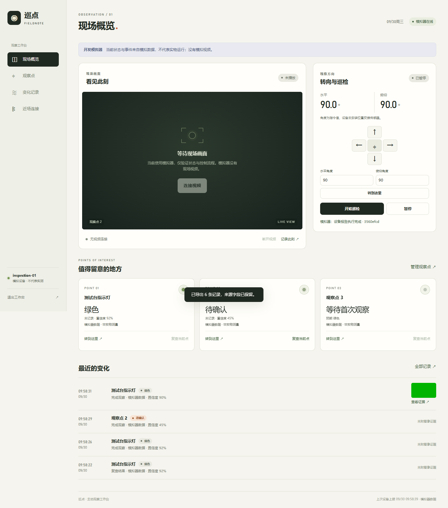
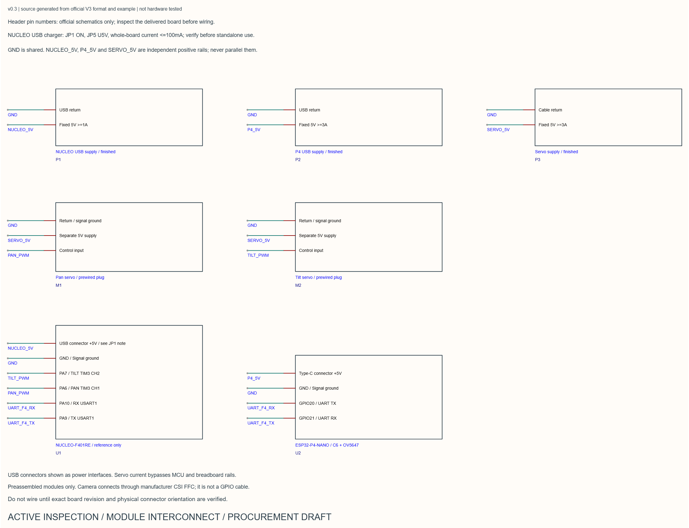

# 巡点 · Active Inspection

给不能直接联网的桌面设备加一个可追溯的观察入口：用有限角度云台访问预设观察点，记录指示灯状态、变化与抓拍证据。项目包含STM32控制核、ESP协处理器集成、网页工作台、Node服务、模拟器和外壳/模块互连设计。



> 截图来自原项目测试记录；模拟器没有现场视频，也不代表实物测量。

## 开发状态

**开发中：软件已可在本机独立模拟，硬件尚未接线、烧录或实测。** 本次开源整理不启动EDA/Bridge、不推进新硬件设计，不以编译代替实物验证。STM32候选构建保持舵机输出禁用。

## 已实现的内容

- 网页工作台：观察点、角度命令、巡检/暂停、事件与证据浏览；模拟来源与实物来源明确分开。
- Node服务：会话认证、Origin/CSRF、WebSocket状态、命令生命周期、持久事件、证据与媒体代理。
- STM32：可移植协议/状态机、有限角度控制逻辑、租约与失联暂停、F401RE离线参考目标。
- ESP协处理器：项目自有通信/ROI分类等逻辑及P4媒体/联网/蓝牙集成源；C6使用锁定官方ESP-Hosted从机与本地配置。
- 机械与电路：自有参数源、STEP/STL/FreeCAD源，以及嘉立创模块互连工程。未提供PCB制造放行结论。

## 技术栈

| 部分 | 技术 |
|---|---|
| 网页 | 原生JavaScript、WebSocket、WebRTC/WHEP、Web Bluetooth |
| 服务 | Node.js **24+**、ws 8.22.0、HTTP/JSON持久化 |
| 控制核 | C11、GCC、STM32F401RE、HAL/CMSIS锁定依赖 |
| 协处理器 | ESP32-P4/C6、ESP-IDF 6.0.2、锁定WebRTC/ESP-Hosted依赖 |
| 结构/互连 | Python参数模型、STEP/STL/FreeCAD、嘉立创EDA原工程与PDF阅读图 |

## 最简运行：本地完整模拟

```powershell
git clone https://github.com/yangwei251003/active-inspection.git
cd active-inspection/software/server
npm ci --ignore-scripts
npm run dev
```

在自己的终端查看本次启动地址和随机登录口令，再打开浏览器登录。服务只监听本机，连接模拟器，不需要硬件、云账户或真实设备令牌。不要把终端口令截图或本机 `data/`、配置文件提交到GitHub。

默认模拟器用于状态与控制流程，**没有现场视频**。真实视频需要单独媒体服务、摄像头及硬件接入，见 [部署与运行边界](docs/running.md)。退出时在自己的终端按Ctrl+C。

## 在线预览

GitHub Pages提供 [界面与设计预览](https://yangwei251003.github.io/active-inspection/)，内容为真实已有截图与项目说明。完整认证、WebSocket和视频服务需要Node后端；静态预览不会冒充后端已在线或设备已连接。

## 软件测试

```powershell
cd software/server
npm test
cd ../web
npm test
```

本次公开副本服务19项、网页27项测试通过。测试使用隔离数据和模拟设备，不读取本机原服务数据，不连接实物。完整记录见 [VALIDATION.md](VALIDATION.md)。

## STM32主机测试与离线交叉编译

需要Python 3、主机GCC；交叉编译还需Arm GNU工具链在PATH。

```powershell
cd firmware/stm32
python build.py --host
python bootstrap_dependencies.py
python verify_dependencies.py
python build.py --arm
```

依赖只获取清单列出的锁定官方文件并逐文件校验；不会重置不匹配的已有文件。源码与生成产物位于被忽略的依赖/构建目录。本次24组主机控制测试、323个依赖文件校验及F401离线编译链接通过；不能据此宣称舵机、相机、无线或整机通过。

## ESP与硬件资料

P4/C6固定版本获取和构建前提见 [REPRODUCE.md](firmware/companion/REPRODUCE.md)。第三方SDK、预编译库和工具不捆绑；不是把SDK示例计作独立原创项目。公开副本本次未重新构建完整P4/C6固件，相关脚本与目标环境仍需按文档验证。



模块图表达设计意图，不是到货板卡的逐针接线保证。三路正电源、模块修订、FFC方向、舵机脉宽与机械限位均需实物核对；本次不下单、不接线、不烧录。

```text
software/server/          Node服务、模拟器与现有测试
software/web/             网页工作台和模型/通信测试
firmware/stm32/           自有控制核、F401参考目标、依赖锁
firmware/companion/       自有P4集成/核心，C6官方依赖配置
hardware/eda/             嘉立创原工程、互连图与阅读文件
mechanical/               自有参数模型、STEP/STL/FreeCAD源
preview/                  GitHub Pages静态项目预览
```

## 更新与许可

更新和待办见 [CHANGELOG.md](CHANGELOG.md)。自有内容采用 [MIT](LICENSE)。ST、Espressif、ws、MediaMTX等依赖仍适用各自许可，尤其部分乐鑫组件有芯片使用限制，见 [THIRD_PARTY_NOTICES.md](THIRD_PARTY_NOTICES.md)。公开排除范围见 [PROVENANCE.md](PROVENANCE.md)，此开发中项目不列为本地可删除。


2026-10-26归档补充：保全原ESP-IDF Windows路径适配补丁与上游许可；见[协处理器复现说明](firmware/companion/REPRODUCE.md#已保全的windows路径补丁)。只验证补丁应用，不扩展为实板或完整构建通过。
