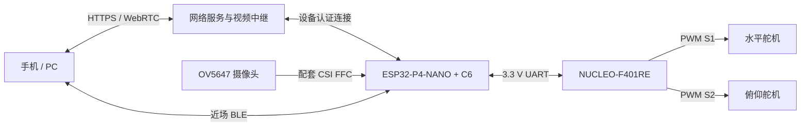

# 电源、候选引脚与布线规则

更新：2026-09-30。**本表绑定官方参考板，属于 V0 文档核对；未核对到货板时不可作为带电接线指令。** 到货后由主工程将照片中的引脚逐一标记，形成最终接线图，用户无需自行查手册或计算电路。

## 系统框图



P4 的相机和无线处理与 F401 的运动时序分别运行。原型没有角度编码器，返回的 pan/tilt 只是指令位置；“到点”必须通过后续画面稳定和重复定位实验确认。

## 电源树：三路成品固定 5 V，低压共地

```text
封闭 USB 电源 A（固定 5 V，额定≥3 A）──成品 USB 线── P4 Type-C
封闭 USB 电源 B（固定 5 V，额定≥1 A）──Mini-B 线──── NUCLEO CN1
封闭 USB 电源 C（固定 5 V，额定≥3 A）──成品供电线──舵机分线模块 +5V
                                                              ├─舵机1 红/V+
                                                              └─舵机2 红/V+
电源 C 低压负极──分线模块 GND ────────────────两舵机 GND（负载回流）
                       └─细信号地──NUCLEO GND──信号地──P4 GND
```

三路正极**不相连**；共地连接只提供信号参考。舵机负载电流沿 C 的成品粗线及分线模块往返，不能经过 NUCLEO 排针、P4 排针或面包板电源轨。A/B 的 USB 正极已经进入各自板卡，不再把它们的 5 V 排针拉线互接。只有一块板带电时，先断开板间 UART，避免通过未上电器件的保护结构反向供电；完整系统先使逻辑板正常运行，再启用舵机电源。

适配器“3 A”是其可提供的额定电流，不是强迫板卡吸收 3 A。三路电流值是选型余量，**不是已测量的整机功耗或堵转数据**。实际 A/C 负载瞬态、线缆压降和温升须测量；禁止用手把舵机堵死来测试电流。若单路保护跳闸，应先断电排查卡滞和接线，不能无条件加大供电。

### NUCLEO 插充电器独立运行的必要检查

MB1136 的 USB 供电与普通手机充电器并非默认完全相同：本次下载的 ST UM1724 Rev 17 §7.5.1（第 21 页）指出，没有 USB 枚举时目标 MCU 可能不供电。

| 场景 | 官方参考条件 | 本项目处理 |
|---|---|---|
| PC 通过 CN1 编程/调试 | JP5 置 U5V（1–2）；JP1 默认 OFF，正常枚举后允许相应 USB 供电 | 保留官方默认状态，先确认 ST-LINK 枚举和目标供电灯；不向板上挂舵机电源负载 |
| 充电器接 CN1 独立运行 | JP5 置 U5V（1–2）；JP1 ON 的路径要求整板及扩展负载不超过 100 mA | 到货核对修订和跳线后，用 USB 表检查独立运行电流；目标 MCU 应正常运行。未测到足够余量前不验收连续独立运行 |
| USB 路径电流不满足上项，采用外部 E5V | 官方 E5V 参考范围 4.75–5.25 V；JP5 2–3、JP1 OFF，按手册要求供电顺序 | 作为工程修订：改成已经焊好的 5 V 端子输出接 CN7-6 E5V 与 CN7-8 GND；必须生成新接线图后执行。不能同时直接并联 USB/U5V/E5V 正极 |

跳帽调整在断电状态下进行。**不要剪断 NUCLEO 的 ST-LINK 区域，不修改焊桥。** 进入 E5V 方案时，应由主工程重新核对实物版本及官方 USB 同时连接步骤，而不是让新手自行推断。

## 候选针号表

唯一候选：ST NUCLEO-F401RE / MB1136 系列与经典 Waveshare ESP32-P4-NANO / C6 版。实际版本、排针正反面与针 1 位置必须照片核验；插针的 “13” 不等于 GPIO13。对 P4 使用 **P1**，不是相邻 P2。

| 连接 | 发出端 | 接收端 | 电平/功能 |
|---|---|---|---|
| F4→P4 串口 | NUCLEO **CN10-21 = PA9 / USART1_TX / AF7** | P4 **P1-15 = GPIO21 / UART_RX** | 3.3 V TTL，115200、8N1 |
| P4→F4 串口 | P4 **P1-13 = GPIO20 / UART_TX** | NUCLEO **CN10-33 = PA10 / USART1_RX / AF7** | 3.3 V TTL，TX 接另一端 RX |
| 两板信号地 | NUCLEO **CN10-9 = GND** | P4 **P1-25 = GND** | 与分线模块 GND 建立共同参考 |
| 水平控制 | NUCLEO **CN10-13 = PA6 / TIM3_CH1 / AF2** | 预装分线模块 S1 → 水平舵机 Signal | 50 Hz 参考 PWM，3.3 V 信号兼容性待舵机资料/实测确认 |
| 俯仰控制 | NUCLEO **CN10-15 = PA7 / TIM3_CH2 / AF2** | 预装分线模块 S2 → 俯仰舵机 Signal | 同上；默认交付固件输出禁用 |
| 舵机正电源 | 独立电源 C +5 V | 分线模块 V+ → 两舵机 V+ | 只承载舵机电流，与 MCU 5 V/3.3 V 引脚隔离 |
| 舵机地/参考 | 电源 C GND/分线模块 GND | 两舵机 GND；另一路至 NUCLEO GND | 回流走成品电源线；信号地不承担电机负载回流 |
| 摄像头 | KIT-A 配套 OV5647/RPi Camera (B) | P4 板 **CSI 摄像头座** | 只用套餐匹配 FFC；不接 DSI 显示屏座，不用杜邦线替代 |

此表与 `../pin-plan.json` 相同。P4 物理针号取自官方原理图 Interface 区，见[官方原理图入口](05-source-register.md)。原理图中 GPIO4/GPIO5 与板载功能有关，**不作为本项目的 UART 候选**。PA2/PA3 留给 NUCLEO 的 ST-LINK 虚拟串口；不切换焊桥。

### C6 首次更新的临时连接

上表是整机运行连线。C6 固件另有更新流程，采用 B14 全预焊 3.3 V 逻辑 USB-TTL，通过已焊好的 P2 接口连接；具体构建前提见 [C6 固件说明](../../firmware/companion/REPRODUCE.md)，针号与下载模式仍须按官方资料和实物版本重新核对。这组临时下载线不属于永久运行网表，不装进外壳。目标板用自己的成品电源，不能用适配器的 VCC 与板卡供电并联；到货核对排针方向后才生成当次接线及下载步骤。更新 P4 不等于更新 C6，不能用出厂版本未知的前提跳过无线固件核验。

### 信号门限与接头识别

F401 与 P4 以 3.3 V TTL 通信；不接 RS-232 的 ±电压口，不接 RS-485 A/B，不以“某些 F4 引脚耐 5 V”推导所有接口都能承受 5 V。P4 端尤其不得加 5 V UART。

MG90S 的 4.8–6 V 工作电压描述的是**电机供电**，不能当作 3.3 V PWM 输入门限证明。供应商需要确认所交付批次接受 3.3 V PWM；若不能确认或低压控制不稳定，采用已焊成品的单向 3.3→5 V 缓冲模块，更新原理图与针表。不得让用户用裸三极管或电阻自己设计。

常见舵机红为 V+、棕/黑为 GND、橙/黄为 Signal，但颜色只作为辅助，必须以该批线序和插座标记为准。三芯接头反插可能直接把电源加在信号端，先断电核对方向后再插到底；禁止仅靠颜色试插。

## 云台与排线边界

初始软件窗口是水平 30–150°、俯仰 45–120°，中位 90/90°，这些是工程限幅并非实测无碰撞范围。首次无负载校准从中位及±5°开始，确认方向后逐步拓展，最终边界可能更窄。不能连续旋转 360°，FFC 不承担拉力，活动部分仅携带摄像头及轻支架，不把整块 P4 放在微型舵机上。

FFC 断电插拔：松开锁扣、按到货照片标出的触点方向平行插到底、扣紧，再检查没有斜插或折痕。相邻同宽插座不能凭“插得进去”判定兼容。弯曲半径和寿命无该批 FFC 数据时不得自造数值；用供应商许可范围和实际小步运动试验决定线圈长度/弯折路线。
