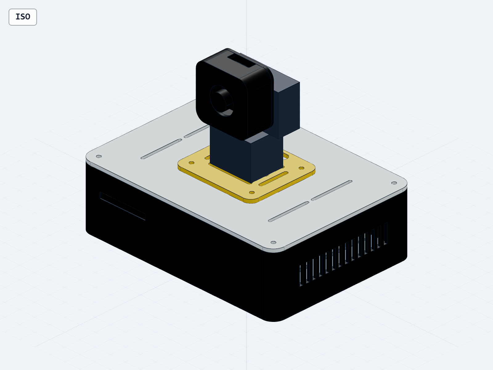

# 主动巡检终端：机械交付

这是采购前结构设计，几何文件可复验，**尚未打印、试装或进行云台运动/温升测试**。请先核对实际板卡和相机 SKU，再决定是否直接打印。所有长度单位为 mm。

可编辑源在 `models/inspection_geometry.py`；STEP 主装配 `models/inspection_terminal.step`；`models/exploded_terminal.step` 为分层拆解示意。`stl/` 仅有本项目打印件，不包含用矩形包络表示的采购模块。原生 FreeCAD 文件保留命名零件与参数说明；上游参数化几何仍以 Python 源为准。

## 打印件清单

主装配实际安装 **15 个打印件 + 5 个采购件参考包络 = 20 个 CAD 实体**。下表建议打印 **16 件：15 件安装 + 1 个备用线束锚点**；备用锚点不放入主装配。可选配合试样另外打印 1 个，不计入这 16 件。5 个采购包络是 CAD 表示数量，不是完整采购 BOM 的件数。

| 文件 | 数量 | 建议材料/颜色 | 作用 |
|---|---:|---|---|
| base_shell.stl | 1 | PETG 深灰 | 外壳底座、散热口、螺丝柱、走线窗口 |
| lid.stl | 1 | PETG 浅灰 | 可拆盖、定位环、排线口 |
| electronics_tray.stl | 1 | PETG | 可调电子托盘 |
| gantry_adapter.stl | 1 | PETG 金黄/同灰 | 云台长槽底板 |
| camera_shell.stl | 1 | PETG 深灰 | 镜头面罩 |
| camera_back.stl | 1 | PETG 深灰 | 相机托板/云台适配 |
| pcb_foot.stl | 8 | PETG/尼龙 | PCB 绝缘支脚，按实际板底避空区放置 |
| cable_anchor.stl | 1 安装 + 1 备用 | PETG | 主装配仅装 1 个；第 2 个单独留作备用，可用薄双面胶固定 |

另附可选 `fit_coupon.stl` 配合试样（36×18×5，不装入设备）。俯视时以六角窝一排在上方：左/中/右的圆通孔为 3.2/3.4/3.6，六角窝对边为 5.6/5.8/6.0；中间一列是本设计标称值。先让实际螺丝、螺母试过中间列；如果不合适，把结果反馈给 Codex，由 Codex 调整参数并重新导出相关件，不能整体缩放模型。试样不覆盖底座侧装螺母槽、耐热或强度验证。

FDM 初始参数：0.4 喷嘴、0.2 层高、3–4 道壁、4 层顶底、15–20% 填充。STL 已归零；盖子文件已翻为定位环朝上，导入切片后不要再翻一次。底座螺母侧槽及侧通风口可能需局部支撑，先让打印服务检查；不得承诺完全免支撑。相机罩正面朝床，内腔朝上。PCB 脚沿高度打印。建议先打印孔/螺母测试小件，再整套打印。PLA 仅作室温试装，不适合高温处长期工作。

## 采购的装配辅料

- M3 × 10 机螺丝 8、M3 螺母 8、M3 平垫圈 8：顶盖与云台托板各 4 组。
- M3 × 16 机螺丝 4、M3 螺母/垫圈各 4：托盘固定。由底座外底面向上穿入，螺母在托盘上方；螺丝端面标称 Z=16，板底 Z=22.8，尚有 6.8 mm 净空。勿倒装让螺杆伸出外底面。
- M3 × 8 塑料自攻螺丝 4：相机罩/后盖，手拧低扭矩；可改为通孔加螺母版本。
- 2.5 mm 小尼龙扎带、可重复魔术贴、薄绝缘泡棉、四枚直径 10 mm、厚度至少 5 mm 的防滑脚。脚垫粘进 0.6 mm 浅凹后，底部螺丝头应离桌面至少 1 mm；以实际螺丝头高度核验。CAD 外形 180×130×139 不含脚垫，安装 5 mm 脚垫后名义高度约 143.4。
- 云台采购必须是卖家已装好的 FIT0415 兼容支架 + 双 MG90S + 匹配舵盘，卖家明确承诺无需买家裁剪舵盘、钻孔或加工。DFRobot 原厂裸套件仅作为参考，不是本方案的零加工采购 SKU。现有通用托板用长槽/绑带适配已装好的非运动底座；它不能替代内部舵盘匹配。若卖家无法满足此项，先换成符合条件的成品云台再核尺寸，不把裁剪步骤交给用户。
- 所有 PCB、摄像头、舵机和供电线均为采购件，不自行焊接。

## 一步一验证装配

1. **空壳试装**：底座放平，确认不翘；4 个螺母能从内部侧槽放入；盖子无外力平放到位。验证后再装电路。
2. **托盘固定**：贴好脚垫，四颗 M3×16 螺丝从底座外底面向上穿过，装空托盘，垫圈/螺母在托盘上方锁紧。验证螺丝头不接触桌面，板底预留高度内没有螺杆尖端；检查底座内没有金属屑和松动螺母。
3. **放绝缘支脚**：按实际 PCB 背面焊点位置放置 4 脚/板，用薄双面胶暂定位。支脚高度 12，不得压住焊点。设计默认杜邦插座从板上方连接；如果实际排针/插头必须朝下，先反馈照片和总高度给 Codex 调整空间，不把长插头硬塞到 12 mm 板下间隙内。
4. **固定两块板**：先单块板，绑带跨过无器件区域；验证轻摇不移位、没有挤压插座。再安装第二块板。勿靠勒紧扎带纠正装配错误。
5. **预制线材引出**：USB 和独立舵机电源线从背面不同开口引出；在线束锚点绑住外皮，留可拔接头。轻拉外线，板上插座不得跟着移动。
6. **云台托板**：长槽对准采购件可用固定孔；如果不匹配，用托板的绑带槽固定云台非运动底座。不能绑住转轴、齿轮或排线。用手托住底座轻转检验。
7. **摄像头固定**：先镜头对准前罩孔，确认无暗角；使用后盖长槽、短支脚/绝缘垫和小扎带固定 PCB，不能压镜头座或 FFC 锁扣。相机板大于 32 × 32 或镜头位置偏心时先改参数，不强装。
8. **排线留 C 环**：断电检查排线无折痕、无锐边接触，不压 FFC 锁扣；不要徒手扭舵机轴，转动检查放到下一步受限点动中。弯曲半径 10 为本设计保守布线目标，不是厂商寿命保证。
9. **上盖与动作测试**：以正确安装后的中位 90° 为基准，先按硬件上电步骤逐轴测试中位±5°。确认方向、停止和线缆后，再小步扩展到本结构的初始检查窗口：水平 60–120°、俯仰 75–105°；每一步确认线缆不绷紧。软件角度是舵机指令值，须实物核对方向和中位；继续扩大范围需要再次检查，不支持无限旋转。
10. **通风检查**：长时间视频和巡检后记录壳内温度、复位和舵机抖动。未测前不得放入密闭柜或覆盖通风口。

## 到货后必须填写的尺寸

| 项目 | 当前包络/设计值 | 到货实测 |
|---|---|---|
| NUCLEO 长×宽×含插头高度 | 82.5 × 70 × 24 | 待填 |
| P4 板 长×宽×含插头高度 | 85 × 56 × 25 | 待填 |
| 相机板/镜头/FFC 朝向 | 25×24 或 32×32 / Ø22开口 | 待填 |
| FIT0415 底部孔距与组合高度 | 长槽适配 / 原厂65高 | 待填 |
| 含螺丝、插头后的最高点 | 盖下总空间52，板底22.8 | 待填 |
| FFC 有效长度、静态弯曲半径 | 待锁定 SKU | 待填 |
| 相机罩与云台实际运动净空 | 静态参考包络，未扫掠实物 | 待填 |

任何一项超出包络：先停止对应装配步骤，反馈尺寸和照片，由 Codex 更新参数和采购件包络、重新生成与检查；你无需自己修改 CAD，不磨 PCB、不强行弯折接口。

## 复验

环境：Python 3.12 + build123d 0.11.1。`build_models.py`、`check_interfaces.py`、`make_snapshots.py` 另外依赖外部 CAD Skill（通过 `CAD_SKILL_PATH` 指定其根目录；未设置时检查常见安装位置）。该第三方 Skill 不随本仓库分发。从本目录运行 `python build_models.py` 生成主 STEP、独立 STEP/STL，并运行 CAD 几何检查；也可在后面写明确模型名只重建该目标。`python verify_design.py` 对照源/STEP 并输出零件体积、材料估算和接口净空；`python check_interfaces.py` 检查 CAD 面配合；`python verify_stl.py` 检查真实 STL 的闭合、连通、绕序和底面；`python make_snapshots.py` 生成核验图。之后用 FreeCAD 自带 Python 执行 `freecad_native.py`，从最终 STEP 创建含 20 个命名实体的新文档、保存并重开，不修改其他工程。`python finish_handoff.py` 汇总证据和浏览链接，不代替实际审图。

历史几何核验摘要见 `VERIFICATION.md`，旧机器日志和浏览服务链接未随公开版分发。本次修复了相机罩角部螺柱侵入 32 mm 相机板投影的问题：螺柱与后盖孔同步外移 1 mm；在每边另留 0.4 mm 的投影检查区内，交叠体积从 76.14 mm³ 变为 0。该结果没有替代实际相机镜头、厚度、连接器或 FFC 的核验。

质量口径：15 个实际安装打印件合计 281,888.87 mm³，按 PETG 密度假设 1.27 g/cm³ 换算，实心约 358.0 g；1 个备用锚点为 1,079.61 mm³ / 1.37 g。建议打印的 16 件合计 282,968.48 mm³ / 359.4 g。填充用料、支撑与实际质量需通过切片和打印核对；这里未运行切片或打印。可选试配件另约 2.77 cm³，按同一密度假设实心约 3.52 g。打印前检查说明见 `PRINT_REQUEST.md`；`fit_check.csv` 的实测栏保留为空。

## 直接查看

使用支持 STEP 的 CAD 软件打开 `models/inspection_terminal.step` 或 FreeCAD 工程 `inspection_terminal.FCStd`。STL 可在常见切片软件中预览；仅打开文件不代表可以直接打印和装配。

